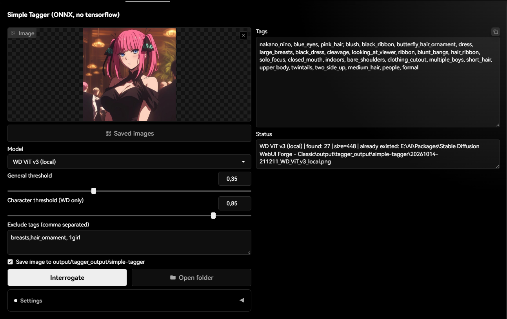
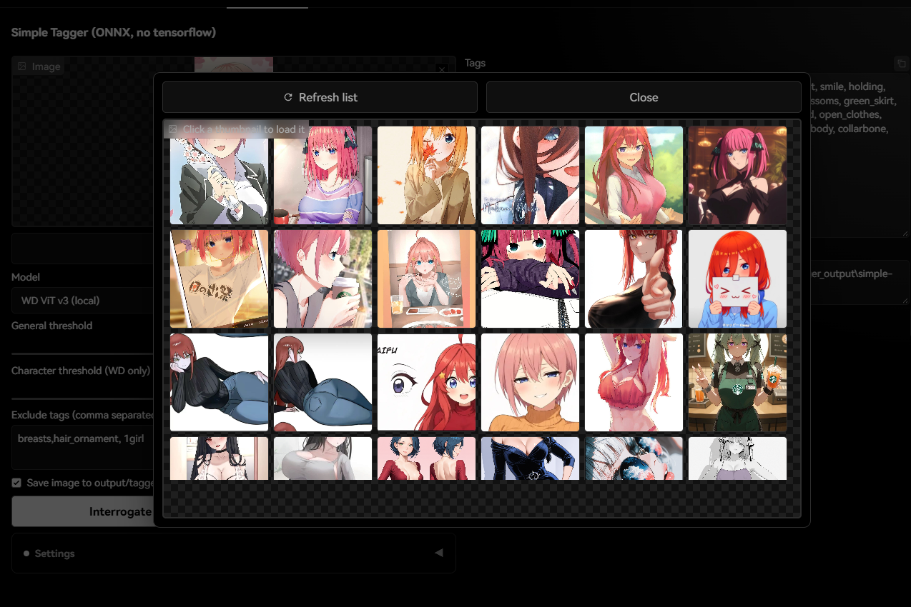

# Simple Tagger for Stable Diffusion WebUI Forge Classic

> A minimal image-tagging tab for **Forge Classic portable** — ONNX only, no tensorflow.

[](LICENSE)

Interrogate any image and get Danbooru-style tags, tunable thresholds, and
one-click copy — without pulling in tensorflow/jax (which break Forge via
protobuf/transformers conflicts).

---

## Screenshots




---

## Features

* **ONNX-only inference** (`onnxruntime`, CPU or CUDA) — WD taggers (CSV labels)
  and Camie tagger v2 (JSON metadata).
* **Curated model list** — v3 family plus MoAT v2, no duplicate generations.
* **Auto-discovery** — any extra `*.onnx + *.csv` (or `*-metadata.json` for Camie)
  found in the search folders appears in the model dropdown as `(auto-local)`.
* **Settings tab section** — UI language, custom models folder, **Rescan** and
  **Download from HuggingFace** buttons.
* **i18n** — every `*.json` in `locales/` becomes a selectable UI language
  (ships with `en` + `uk`, English default). Language applies live, no restart.
* **Persistent settings** — `settings.json` next to the extension is the single
  source of truth; components opt out of Forge `ui-config.json`
  (`do_not_save_to_config`) so values survive restarts.
* **Result gallery** — saves interrogated images under
  `output/tagger_output/simple-tagger`, skips pixel-identical duplicates, and
  lets you click a thumbnail to reload it.

---

## Installation (Forge Classic portable only)

1. Copy (or `git clone`) this folder into your extensions directory:
   `<forge-classic>\extensions\simple-tagger`
2. Restart Forge. `install.py` pulls in `onnxruntime` + `huggingface_hub`
   automatically on first start.
3. Open the **Simple Tagger** tab.

> Not tested with A1111 — Forge Classic only.

---

## Models

| Dropdown entry      | Type  | Source repo |
|---------------------|-------|-------------|
| WD ViT v3 (local)   | WD    | `SmilingWolf/wd-vit-tagger-v3` |
| Camie v2 (local)    | Camie | local weights only |
| WD EVA02 Large v3   | WD    | `SmilingWolf/wd-eva02-large-tagger-v3` |
| WD SwinV2 v3        | WD    | `SmilingWolf/wd-swinv2-tagger-v3` |
| WD ConvNext v3      | WD    | `SmilingWolf/wd-convnext-tagger-v3` |
| WD MoAT v2          | WD    | `SmilingWolf/wd-v1-4-moat-tagger-v2` |

Models download on first use. WD weights land in
`<models_path>/tagger_models/<dirname>/`.

### Where the extension looks for weights

In order, first hit wins:

1. **Custom folder** from Settings (flat `<basename>.onnx` + `<basename>.csv`,
   or `<basename>.onnx` + `<basename>-metadata.json` for Camie) — this is how
   you reuse weights from other installs (e.g. a ComfyUI `models/` folder):
   just point the setting at it.
2. `<models_path>/tagger_models` — the shared Forge storage, incl. the
   canonical `<dirname>/model.onnx` + `selected_tags.csv` HF cache layout.
3. `models/` inside this extension (good for a fully self-contained install).
4. **HuggingFace** — auto-download on first use, or on demand via the
   *Download selected model* button.

Use **Rescan models** after adding/removing weight files.

---

## Settings

Stored in `settings.json` (created on first run, git-ignored). Copy
`settings.example.json` → `settings.json` to pre-seed values:

```json
{
  "model": "WD ViT v3 (local)",
  "gen_thresh": 0.35,
  "char_thresh": 0.85,
  "exclude": "",
  "save": true,
  "lang": "en",
  "custom_dir": "",
  "verbose": false
}
```

Console output is quiet by design: one `ready:` line at UI start, plus
warnings/errors only. Set `"verbose": true` in `settings.json` if you need the
old full-dict logging on every load/save.

## Adding a language

Drop a new `<code>.json` into `locales/` mirroring `en.json` keys
(`"_name"` holds the display name). It appears in the language dropdown
automatically — no code changes needed.

---

## Repository layout

```
forge-simple-tagger/
├── scripts/simple_tagger.py   # the extension (Forge loads scripts/*.py)
├── locales/en.json, uk.json   # UI dictionaries (*.json = a language)
├── models/.gitkeep            # optional self-contained weights dir
├── install.py                 # Forge auto-installs onnxruntime + huggingface_hub
├── settings.example.json      # seed values for settings.json
├── .gitignore                 # ignores settings.json, models/, __pycache__
├── LICENSE                    # MIT
└── README.md
```

---

## License

MIT — see [LICENSE](LICENSE).
